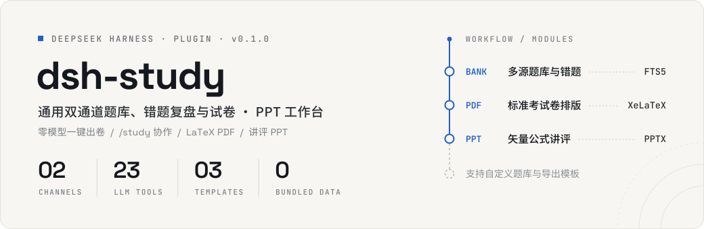

<div align="center">
<picture>
  <source media="(prefers-color-scheme: dark)" srcset=".github/assets/hero-dark.svg" />
  <source media="(prefers-color-scheme: light)" srcset=".github/assets/hero.svg" />
  
</picture>
<p>
  <a href="LICENSE"></a>
  <a href="package.json">=24" src="https://img.shields.io/badge/node-%E2%89%A524-3A7BE0?style=flat-square&labelColor=24292F&logo=node.js&logoColor=white" /></a>
  <a href="package.json"></a>
  <a href="src/host/db.js"></a>
</p>
<p>
  
  &nbsp;<strong>DeepSeek Harness</strong>
  &nbsp;&nbsp;·&nbsp;&nbsp;
  
  &nbsp;<strong>词元工坊（TokenWorks）</strong>
</p>
<p>
  <a href="#双通道架构">01 双通道架构</a> &nbsp;&nbsp;
  <a href="#安装与使用">02 安装与使用</a> &nbsp;&nbsp;
  <a href="#模板与导出">03 模板与导出</a> &nbsp;&nbsp;
  <a href="#题库协议与示例">04 题库协议与示例</a> &nbsp;&nbsp;
  <a href="#仓库结构">05 仓库结构</a>
</p>
</div>

面向 **DeepSeek Harness (DSH)** 与 **词元工坊（TokenWorks）** 的**通用双通道刷题、错题复盘与试卷 / PPT 生成插件**。适配任意学科的本地私有题库、GitHub 仓库或 HTTP 题库源，支持零大模型一键点选直出，也支持通过 `/study` 斜杠指令与大模型深度协作（自然语言精准出卷、拍照/文字录错题、撰写针对性红字点评与讲评课件）。

> **数据与版权边界**：插件本身采用 [MIT License](LICENSE)，**不内置任何课程真题或题库数据**。所有题库均由用户在运行时按需接入或同步（默认暂预置一个公开示例源 [DDNdles/USTC-Question-Bank](https://github.com/DDNdles/USTC-Question-Bank)，同时随包附带最小自建题库模板 [examples/sample-bank/](examples/sample-bank/)），经 Schema 与 SHA-256 校验后存储于本机独立数据目录。


## 双通道架构

| 通道 | 入口 | 大模型参与 | 典型场景 |
| --- | --- | --- | --- |
| **通道一：零模型直出工作台** | 左侧边栏「学习」面板 | **不参与** | 点选课程/知识点/题型/答案来源，一键生成并在线预览标准考试卷 PDF 与讲评 PPT；管理多源题库与 SM-2 错题本 |
| **通道二：大模型协作助手** | 对话输入框 `/study` | **深度协作** | 自然语言定制出卷、分析薄弱点、文字/截图录错题（草稿确认后入库）、为每道题撰写红字易错点评并导出 PDF / PPT |

- 两条通道共用同一套本地 SQLite FTS5 索引、SM-2 复习调度与 PDF / PPT 渲染引擎。
- `/study` 弹出快捷菜单（智能定制出卷、录入错题、错题复盘与巩固出卷、制作讲评 PPT、查看本地题库状态、打开「学习」工作台），背后静默注入协作规范并暴露 26 个 `study_*` 原生工具，不向 `/` 技能区增加多余噪音。


## 安装与使用

### 运行要求

| 依赖 | 要求 | 说明 |
| --- | --- | --- |
|  DeepSeek Harness /  词元工坊 | `>= 0.2.2-rc.1 < 0.3.0` | 同时兼容 DeepSeek Harness 与词元工坊桌面端 |
| Node.js | `>= 24.0.0` | 使用内置 `node:sqlite`（含 FTS5） |
| XeLaTeX（可选 · 支持一键自动安装） | TeX Live / MiKTeX / 内置 TinyTeX | 启动自动检测本机与常见安装路径；若未安装，可在工作台点击「一键安装」自动部署轻量 TinyTeX 及中文/试卷宏包（约 70 MB，免管理员权限），也可降级导出可打印网页版（KaTeX） |

### 安装插件

可直接从 [Releases](https://github.com/DDNdles/dsh-study/releases) 下载最新 `dsh-study-0.1.6.tgz`，或从源码自行构建：

```bash
git clone https://github.com/DDNdles/dsh-study.git
cd dsh-study
npm install
npm run verify
npm pack
```

**方式一：DeepSeek Harness 安装**

```bash
dsh plugin add ./dsh-study-0.1.6.tgz
```

**方式二：词元工坊安装**

在词元工坊左侧或设置中打开「插件管理」，选择本地安装 `.tgz` 包（`dsh-study-0.1.6.tgz`）；或在桌面端完全退出后通过命令行写入 `desktop` profile。

安装完成后，请从系统托盘**完全退出并重启客户端**：
1. 在左侧边栏打开 **「学习」 → 「题库管理」**，按需勾选课程同步到本地即可离线使用。
2. 若本机尚未安装 LaTeX，「快速出卷」面板会自动提示并支持点击 **「一键安装」** 部署轻量排版环境。
3. 在 **「快速出卷」** 直接点选课程、题量与模板一键生成并预览 PDF / PPT；或在对话中输入 `/study` 让大模型协作定制。


## 模板与导出

| 模板 ID | 格式 | 名称 | 特性说明 |
| --- | --- | --- | --- |
| `ustc-exam`（默认） | PDF | 高校标准考试卷（中科大版式） | 奇数页装订线、动态得分表、黑体解/证明、红色点评块；支持「题目后附解析」与「原题与答案分开」两种版式 |
| `gaokao` | PDF | 全国标准考试卷（高考版式） | 卷头注意事项、大题赋分、连续编号；同样支持解析版与分开版 |
| `review-classic` | PPTX | 经典讲评 PPT | 16:9 宽屏，封面扁平多边形 + 内页流线型题目进度轨道与素雅底纹；`mathjax-full` 行内矢量公式混排、长解析自动分页不截断；内置 OFL 静态字体（`Noto Sans SC` + `Space Grotesk`），跨平台视觉一致 |

- **自定义模板扩展**：可在本地数据目录 `~/.dsh/dsh-study/templates/{pdf,ppt}/<template_id>/` 放入 `template.json`（及 `.tex` 模板）扩展自定义版式，无需改动插件源码。
- **演讲者备注**：导出 PPTX 时自动将题目出处、知识点、难度、答案来源与完整解析写入 Speaker Notes，保持幻灯片页面干净克制。


## 题库协议与示例

插件采用开放的结构化题库协议 v1.0（JSON Schema 见 [schemas/](schemas/)），适用于大学各学科、中学、考研或个人笔记等任意题库。同步任意题库源时均执行 Schema 与 SHA-256 完整性校验，支持四种接入方式：

- **本地目录**（离线导入个人或团队私有题库）
- **HTTP Manifest**（静态站点 / GitLab Raw / 对象存储托管，当前默认预置国内直连的 [USTC GitLab 镜像](https://git.ustc.edu.cn/zzl_stella05/USTC-Question-Bank)）
- **GitHub 仓库**（同时预置公开示例源 [DDNdles/USTC-Question-Bank](https://github.com/DDNdles/USTC-Question-Bank)，支持自由增删与配置加速镜像）
- **Git 仓库**

### 自建题库示例模板

插件内置了一套最小原创示例题库 [examples/sample-bank/](examples/sample-bank/)（1 门示例课程 `DEMO101`，含单选、填空、解答各 1 题与 2 级知识点树），可直接用于离线体验或复制改造：

```bash
# 修改 courses/<课号>/questions.jsonl 或 taxonomy.json 后，一键刷新统计与 SHA-256
cd examples/sample-bank
node refresh-manifest.mjs
```

随后在 DSH「题库管理 → 添加题库源 → 本地目录」中填入该目录路径即可同步。


## 仓库结构

```text
dsh-study/
├── src/
│   ├── client.js                 # DSH 前端工作台（快速出卷 / 题库与错题 / 题库管理）、/study 菜单与错题草稿抽屉
│   └── host/
│       ├── index.js              # 插件入口、RPC 路由、只读预览接口与 systemPrompt 静默注入
│       ├── db.js                 # SQLite + FTS5 数据层
│       ├── sources.js            # 多源拉取、Schema 校验与 SHA-256 增量同步
│       ├── mistakes.js           # 错题本、草稿确认门控与 SM-2 复习调度
│       ├── feedback.js           # 题目纠错反馈（本地留档 + 预填 GitLab/GitHub Issue + 可选 Webhook 直推）
│       ├── papers.js             # 条件组卷、自定义挑题、分值/顺序调整与点评更新
│       ├── latex-env.js          # XeLaTeX 多路径自动检测与轻量 TinyTeX 一键安装
│       ├── render.js             # XeLaTeX PDF / 可打印 HTML / PPTX + MathJax 矢量混排引擎
│       └── tools.js              # 26 个 study_* 原生大模型工具
├── templates/
│   ├── pdf/{ustc-exam,gaokao}/   # 内置 PDF 试卷 LaTeX 模板
│   └── ppt/review-classic/       # 内置讲评 PPT 模板、素雅底图、极简图标与 OFL 静态字体
├── schemas/                      # manifest / meta / taxonomy / question v1.0 JSON Schema
├── skills/dsh-study/SKILL.md     # 通道二大模型协作规范
├── examples/sample-bank/         # 自建题库最小原创模板与 SHA-256 刷新脚本
├── scripts/build.mjs             # esbuild 打包脚本
└── tests/core.test.js            # 12 项端到端核心单测（同步、校验、跨源检测、中文搜索、题目反馈、错题、组卷、LaTeX 检测、PDF/PPT 渲染）
```

<details>
<summary>展开查看 26 个内置大模型工具（study_*）一览</summary>

| 分类 | 工具名 | 作用 |
| --- | --- | --- |
| 题库与检索 | `study_source_list` / `study_source_add` / `study_source_sync` | 查看、添加与同步题库源 |
| 题库与检索 | `study_taxonomy_list` / `study_question_search` / `study_question_get` | 查询真实知识点树、FTS5 检索与读取单题详情 |
| 错题与复习 | `study_mistake_mark` / `study_mistake_list` / `study_mistake_review` | 标记错题、查询待复习列表与 SM-2 打卡 |
| 错题录入门控 | `study_mistake_ingest_draft` / `study_mistake_draft_list` / `study_mistake_commit` | 暂存录题草稿，经用户显式确认后落盘 |
| 组卷与点评 | `study_paper_assemble_mistakes` / `study_paper_assemble_exam` / `study_paper_assemble_custom` | 按错题、条件/大题蓝图或精选列表组卷 |
| 试卷维护 | `study_paper_get` / `study_paper_list` / `study_paper_items_update` / `study_paper_comment_update` | 读取试卷、调整顺序与分值、撰写针对性红字点评 |
| AI 变式门控 | `study_paper_variant_propose` / `study_paper_variant_commit` | 默认关闭；显式开启并确认后方可写入 AI 变式题 |
| 模板与导出 | `study_template_list` / `study_export_render` | 列出内置/自定义模板并导出 PDF、HTML 或 PPTX |
| 环境依赖 | `study_env_check` / `study_env_install_latex` | 自动检测本机/托管 `xelatex` 状态，经用户确认后一键安装轻量 TinyTeX |
| 题目反馈 | `study_question_feedback` | 提交题目纠错反馈并生成预填 GitLab/GitHub Issue 链接（支持可选 Webhook 直推） |

</details>
